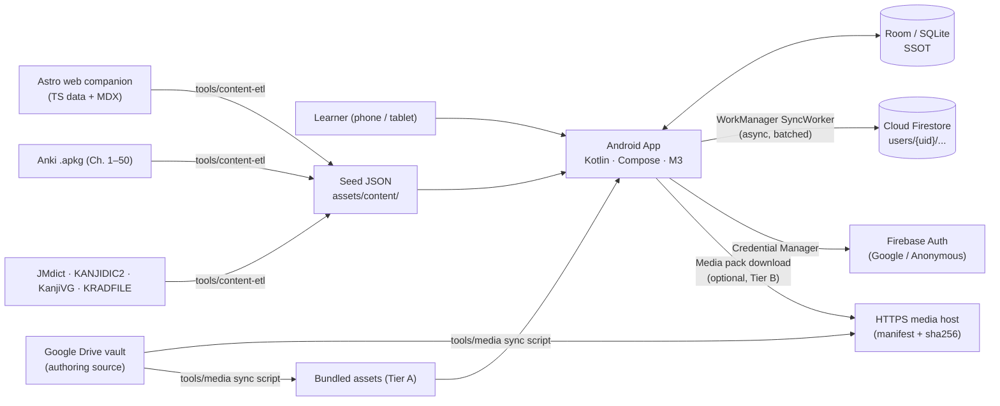
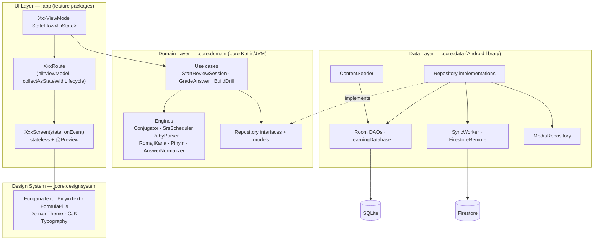
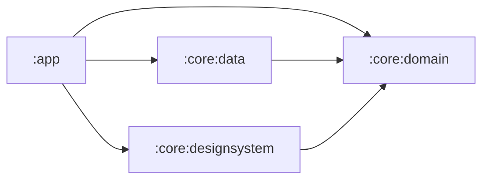
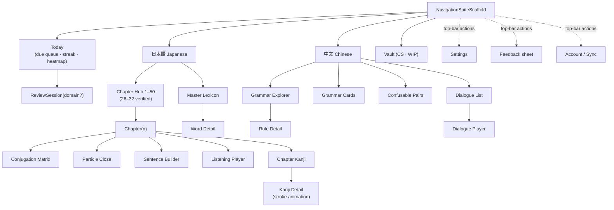
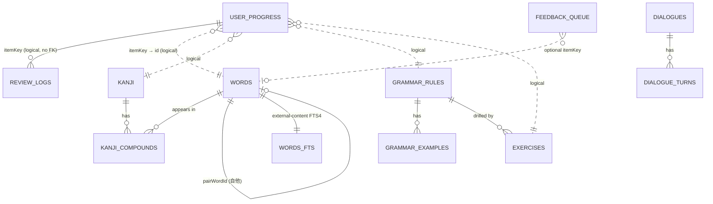
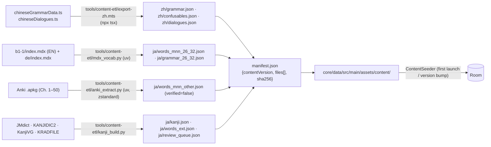
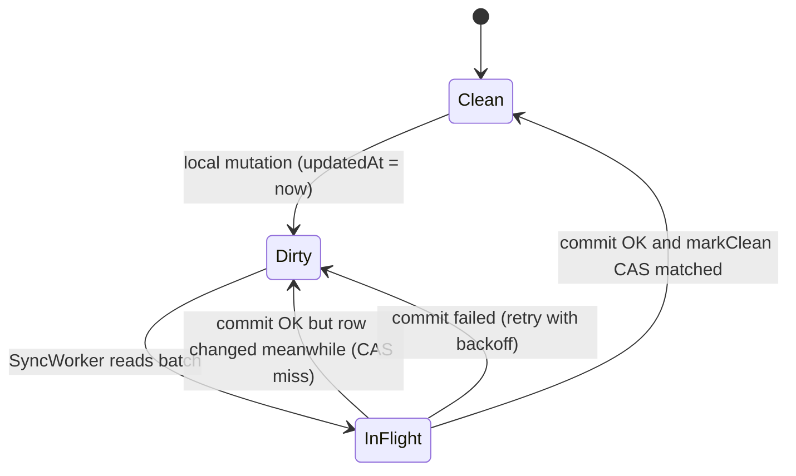

# 01 — System Architecture Specification
## Offline-First Multi-Domain Learning App (Japanese · Chinese · Academic Vault)

| Field | Value |
| :--- | :--- |
| Document | `docs/01_SYSTEM_ARCHITECTURE.md` (companion: [`02_HANDOFF_ROADMAP.md`](02_HANDOFF_ROADMAP.md)) |
| Version | 1.0 — 2026-11-01 |
| Author role | Principal Android & Cognitive Systems Architect |
| Primary executor | Gemini Flash (Actor M_a) inside Google Antigravity |
| Target repo | `git@github.com:NikkuIsRyu/Learning_App.git` |
| Base package | `tech.nikku.learningapp` |
| Status | **Normative.** Where this document says MUST, the implementing agent has no latitude. |

---

## 0. Grounding — What Already Exists (verified 2026-11-01)

This spec is grounded in artifacts discovered on the client's machine. The implementing agent MUST treat these as the canonical content sources and MUST NOT re-invent content.

| Source | Location (Windows PC) | Content | Used for |
| :--- | :--- | :--- | :--- |
| Japanese B1.1 reference (EN) | `Website_project/src/content/docs/lectures/languages/japanese/b1-1/index.mdx` | Lessons 26–32 grammar sections (`### 26.1 …`), conjugation master tables, **335 verified vocab rows** (L26: 45 · L27: 41 · L28: 54 · L29: 51 · L30: 48 · L31: 39 · L32: 57), errata audit (11 Japanese + 3 gloss fixes) | Japanese seed: words, grammar, errata golden tests |
| Japanese B1.1 reference (DE) | `…/japanese/b1-1/de/index.mdx` | German glosses + German grammar terminology | `meaningDe`, `titleDe`, `summaryDe` |
| Anki deck | `Japanese__Minna no Nihongo 1 & 2 (Chapters 1-50).apkg` (path to be supplied by user) | Chapters 1–50 vocab (zstd-compressed `collection.anki21b`) | Unverified vocab for chapters 1–25 & 33–50 |
| Chinese grammar data | `Website_project/src/data/chineseGrammarData.ts` | `GrammarRule` ×26 (7 categories, Lessons 2–10), `ConfusablePair` ×6 | Chinese grammar explorer, grammar cards, confusables |
| Chinese dialogues | `Website_project/src/data/chineseDialogues.ts` | `DialogueData` ×18 (`Dialogue2_1` … `Dialogue10_2`), speakers, per-turn hanzi/pinyin/DE/EN + `startS/endS` | Dialogue player |
| Dialogue audio | `Website_project/public/audio/dialogues/*.mp3` + `*_timestamps.json` | 18 MP3 (GPT-SoVITS voices) + ms timestamps | Bundled audio (Tier A) |
| Web components | `Website_project/src/components/chinese/*.astro` | `ChineseGrammarExplorer`, `ConfusableCard`, `GrammarCard`, `DialoguePlayer` | Behavioural reference for the native port |
| Media vault | `${HOME}/GoogleDrive/University/...` (`G:\Meine Ablage\University\` on PC) | Large media | Tier B media packs |

> [!WARNING]
> **Copyright.** Minna no Nihongo vocabulary/sentences (3A Corporation) and iMina-derived content are copyrighted. They are acceptable for *personal study use*, but `Learning_App` SHOULD be a **private** repository, or the content packs (`core/data/src/main/assets/content/ja/`) MUST be excluded from any public remote. Open data sets used for extended content (JMdict, KANJIDIC2, KanjiVG, KRADFILE) are CC BY-SA and require an in-app attribution screen (§6.5).

---

## 1. Architectural Drivers

| # | Quality attribute | Concrete requirement | Architectural response |
| :--- | :--- | :--- | :--- |
| QA-1 | **Zero-latency offline study** | Any review/drill interaction < 16 ms UI, < 50 ms DB, no network on the critical path | Room = Single Source of Truth (SSOT); content bundled; sync is asynchronous (§8) |
| QA-2 | **Content correctness** | Errata-fixed data for L26–32 must never regress | Stable IDs, `verified` flags, golden errata tests in CI (§6.4) |
| QA-3 | **Progress durability** | User progress must survive app updates, content re-seeding, and device changes | Progress decoupled from content (no FK), no destructive migrations, event-sourced review log (§8.4) |
| QA-4 | **Agent-executability** | A smaller model (Gemini Flash) must implement it ticket-by-ticket with automatic verification | Pure-Kotlin domain module (fast JVM tests), stateless previewable screens, explicit gates (G0–G5) |
| QA-5 | **Domain extensibility** | CS/Academic vault arrives later without schema rewrite | `Domain` enum on every content row; generic `ItemType`-based SRS |
| QA-6 | **Better-than-iMina pedagogy** | Generative drills, instant explanatory feedback, SRS on micro-skills | Rule-based conjugator (generates infinite drills), SRS per *(verb × form)* cell (§7) |

---

## 2. System Context



**Key principle:** content flows *one-way* (build time → APK → Room). User state flows *two-way* (Room ⇄ Firestore). These two flows never share tables with foreign keys.

---

## 3. Layered Architecture (MVVM + Clean Architecture)

### 3.1 Layer Diagram



### 3.2 Gradle Module Graph & Dependency Rule



| Module | Plugin type | May depend on | MUST NOT depend on |
| :--- | :--- | :--- | :--- |
| `:core:domain` | Kotlin/JVM library (+ kotlinx-serialization) | kotlinx-coroutines-core, kotlinx-serialization-json | Any `android.*` / `androidx.*` class |
| `:core:data` | Android library | `:core:domain`, Room, DataStore, WorkManager, Firebase, Media3 (cache only) | `:app`, Compose UI |
| `:core:designsystem` | Android library + Compose | `:core:domain` (for `RubyParser`, `Pinyin`) | `:core:data` |
| `:app` | Android application + Compose + Hilt | all of the above | — |

> [!NOTE]
> The 4-module split is deliberate: it is the minimum that (a) physically enforces the Clean-Architecture dependency rule and (b) lets the Evaluator run the most important logic tests (`:core:domain:test`) in seconds on the JVM, without Robolectric or an emulator. Feature modules are intentionally **packages** inside `:app` to keep Gradle configuration simple for the Actor model.

### 3.3 Source Layout (normative)

```text
Learning_App/
├── AGENTS.md                         # Agent operating rules (read first)
├── docs/                             # This spec, roadmap, PROGRESS ledger, ENVIRONMENT
├── .system_generated/reflections.md  # Reflexion episodic memory (committed)
├── tools/
│   ├── agent/gate.ps1 · preview.ps1  # Evaluator wrappers (Phase 0)
│   ├── content-etl/                  # Node(tsx) + Python(uv) ETL → seed JSON
│   └── media/                        # Drive → assets/manifest sync
├── gradle/libs.versions.toml
├── app/src/main/kotlin/tech/nikku/learningapp/
│   ├── LearningApplication.kt        # @HiltAndroidApp, WorkManager config
│   ├── MainActivity.kt
│   ├── navigation/                   # TopLevelDestination, Routes (@Serializable), AppNavHost
│   └── feature/
│       ├── today/                    # Cross-domain due queue, streak, heatmap
│       ├── review/                   # Generic SRS session host
│       ├── japanese/{hub,chapter,conjugation,particle,scramble,listening,lexicon,kanji}
│       ├── chinese/{grammar,cards,confusables,dialogues}
│       ├── vault/                    # CS "Work in Progress"
│       ├── settings/ · feedback/ · auth/
│       └── shared/player/            # AudioPlayerController (Media3), DialoguePlayer UI
├── core/domain/src/main/kotlin/tech/nikku/learningapp/core/domain/
│   ├── model/ · repository/ · usecase/
│   └── engine/{conjugation,srs,text,exercise}
├── core/data/
│   ├── schemas/                      # Room exported schemas (committed)
│   └── src/main/{kotlin/.../core/data/{local,content,repository,sync,media,di}, assets/content/}
└── core/designsystem/src/main/kotlin/.../core/designsystem/{theme,component}
```

### 3.4 UI Contract (Unidirectional Data Flow) — MUST

Every screen is split in three parts. This is the single most important rule for the Evaluator's preview gate (G3), because Compose previews cannot construct Hilt ViewModels.

```kotlin
// 1) Route: wiring only
@Composable
fun LexiconRoute(onOpenWord: (String) -> Unit, vm: LexiconViewModel = hiltViewModel()) {
    val state by vm.state.collectAsStateWithLifecycle()
    val paged = vm.results.collectAsLazyPagingItems()
    LexiconScreen(state = state, results = paged, onEvent = vm::onEvent, onOpenWord = onOpenWord)
}

// 2) Screen: stateless, previewable
@Composable
fun LexiconScreen(state: LexiconUiState, results: LazyPagingItems<WordUi>, onEvent: (LexiconEvent) -> Unit, onOpenWord: (String) -> Unit) { /* ... */ }

// 3) Preview: fake state only — never hiltViewModel(), never a real DB
@Preview(name = "Lexicon – light", showBackground = true)
@Preview(name = "Lexicon – dark", uiMode = Configuration.UI_MODE_NIGHT_YES)
@Composable private fun LexiconScreenPreview() = LearningTheme { LexiconScreen(LexiconUiState.preview(), flowOf(PagingData.from(WordUi.samples)).collectAsLazyPagingItems(), {}, {}) }
```

- `UiState` = immutable `data class` (or sealed `Loading/Content/Empty/Error`).
- `Event` = sealed interface; ViewModel exposes exactly one `fun onEvent(e: XxxEvent)`.
- One-shot effects (navigation, snackbars) via `Channel<Effect>` received in the Route.

### 3.5 Navigation Map

Top level uses Material 3 adaptive `NavigationSuiteScaffold` (bottom bar on phones, rail on tablets/foldables). Routes are `@Serializable` objects/classes (type-safe Navigation Compose).



---

## 4. Identity & Content Addressing

Stable, human-readable, globally unique IDs are the backbone of re-seeding and sync (QA-2, QA-3).

| Item | ID pattern | Example |
| :--- | :--- | :--- |
| Japanese word (Minna) | `ja:mnn:{chapter2}:w{order3}` | `ja:mnn:29:w016` (拭きます) |
| Japanese word (extended) | `ja:ext:{jmdictSeq}` | `ja:ext:1358280` |
| Kanji | `ja:kanji:{literal}` | `ja:kanji:探` |
| Japanese grammar | `ja:mnn:{chapter}.{section}` | `ja:mnn:30.2` |
| Chinese grammar | `zh:g:{webId}` | `zh:g:bi-comparison-rule` |
| Chinese confusable | `zh:c:{webId}` | `zh:c:zai-vs-you` |
| Dialogue | `{lang}:d:{webId}` | `zh:d:Dialogue2_1` |
| Exercise | `{lang}:x:{chapter}:{type}:{n3}` | `ja:x:27:particle:004` |
| Conjugation cell (SRS) | `conj:{wordId}:{VerbForm}` | `conj:ja:mnn:27:w003:POTENTIAL` |

Rules (enforced by `ContentValidationTest`): IDs are immutable once shipped; never contain `/` (Firestore doc-ID constraint); max 180 chars; errata fixes **edit the row, never re-key it**.

---

## 5. Data Model

### 5.1 Entity-Relationship Overview



> [!IMPORTANT]
> `user_progress` and `review_logs` intentionally have **no foreign keys** to content tables. A content re-seed (upsert/delete) can therefore never cascade into user data. Orphans (progress for removed content) are filtered out by joins and are harmless.

### 5.2 Domain Enums & Value Types — `:core:domain` (`model/`)

```kotlin
package tech.nikku.learningapp.core.domain.model

import kotlinx.serialization.SerialName
import kotlinx.serialization.Serializable

enum class Domain { JAPANESE, CHINESE, ACADEMIC }
enum class ItemType { WORD, KANJI, GRAMMAR, EXERCISE, CONJUGATION_CELL, CONFUSABLE }
enum class PartOfSpeech { NOUN, PRONOUN, VERB, I_ADJECTIVE, NA_ADJECTIVE, ADVERB, PARTICLE, CONJUNCTION, COUNTER, MEASURE_WORD, EXPRESSION, OTHER }
enum class VerbGroup { GODAN, ICHIDAN, SURU, KURU }             // Minna: Group I, II, III(する), III(来る)
enum class Transitivity { TRANSITIVE, INTRANSITIVE, BOTH }        // 他動詞 / 自動詞
enum class JlptLevel { N5, N4, N3, N2, N1 }
enum class ContentSource { MINNA, COURSE, EXTENDED, USER }
enum class ExerciseType { CONJUGATION, PARTICLE_CLOZE, SCRAMBLE, LISTENING, MEANING_RECALL, KANJI_READING, GRAMMAR_CARD, CONFUSABLE_CHOICE }
enum class VerbForm { MASU, DICTIONARY, NAI, TA, TE, POTENTIAL, VOLITIONAL, PASSIVE, CAUSATIVE, CAUSATIVE_PASSIVE }
enum class SrsState { NEW, LEARNING, REVIEW, RELEARNING, SUSPENDED }
enum class ReviewGrade { AGAIN, HARD, GOOD, EASY }
enum class FeedbackKind { BUG, CONTENT_ERRATUM, SUGGESTION }
enum class ListeningTask { DICTATION, COMPREHENSION_MCQ, SHADOWING }

/** Role used for syntactic colour-coding of grammar formulas ("formula pills"). */
@Serializable enum class SyntaxRole { SUBJECT, TOPIC, TIME, PLACE, MODAL, NEGATION, VERB, OBJECT, COMPLEMENT, PARTICLE, MEASURE, CONNECTOR, LITERAL }

@Serializable data class PatternToken(val text: String, val role: SyntaxRole)

/** One Hanzi with tone (0 = neutral) — ported from web `breakdown`. */
@Serializable data class CharBreakdown(val char: String, val pinyin: String, val tone: Int)

@Serializable data class SpeakerInfo(
    val label: String, val labelEn: String? = null,
    val role: String, val roleEn: String? = null,
    val voice: String? = null, val gender: String, val colorHex: String,
)

@Serializable data class SentenceSample(val text: String, val romanization: String, val translationEn: String, val translationDe: String? = null)
@Serializable data class WrongSample(val text: String, val romanization: String, val explanationEn: String, val explanationDe: String? = null)

@Serializable data class ConfusableSide(
    val term: String, val romanization: String,
    val conceptEn: String, val conceptDe: String? = null,
    val formula: String, val ruleEn: String, val ruleDe: String? = null,
    val correct: SentenceSample, val incorrect: WrongSample,
)

/** Polymorphic exercise payloads. JSON discriminator key = "kind". */
@Serializable sealed interface ExercisePayload {
    @Serializable @SerialName("conjugation")
    data class Conjugation(val wordId: String, val from: VerbForm, val to: VerbForm, val polite: Boolean = false, val acceptedOverrides: List<String> = emptyList()) : ExercisePayload

    @Serializable @SerialName("particle_cloze")
    data class ParticleCloze(val segments: List<ClozeSegment>, val translationEn: String, val translationDe: String? = null) : ExercisePayload

    @Serializable @SerialName("scramble")
    data class Scramble(val chunks: List<String>, val acceptedOrders: List<List<Int>>, val distractors: List<String> = emptyList(), val translationEn: String, val translationDe: String? = null) : ExercisePayload

    @Serializable @SerialName("listening")
    data class Listening(val dialogueId: String, val turnIdx: Int, val task: ListeningTask, val options: List<String> = emptyList(), val answers: List<String>) : ExercisePayload
}

@Serializable sealed interface ClozeSegment {
    /** `ruby` uses canonical ruby markup, e.g. "{窓|まど}" (see §7.4). */
    @Serializable @SerialName("text") data class Text(val ruby: String) : ClozeSegment
    @Serializable @SerialName("blank") data class Blank(
        val answers: List<String>,               // accepted particles, e.g. ["が"]
        val options: List<String>,               // chips shown, e.g. ["は","が","を","に"]
        val feedback: Map<String, String> = emptyMap(), // wrong option → explanation
        val ruleRef: String? = null,             // grammar rule id for "Learn why"
    ) : ClozeSegment
}
```

### 5.3 Room Entities — `:core:data` (`local/entity/`)

```kotlin
package tech.nikku.learningapp.core.data.local.entity

import androidx.room.*
import tech.nikku.learningapp.core.domain.model.*

// ───────────────────────────── CONTENT (read-mostly, re-seedable) ─────────────────────────────

@Entity(
    tableName = "words",
    indices = [
        Index(value = ["domain", "chapter", "orderInChapter"]),
        Index(value = ["domain", "jlpt"]),
        Index(value = ["domain", "pos"]),
        Index(value = ["reading"]),
        Index(value = ["pairWordId"]),
    ],
)
data class WordEntity(
    @PrimaryKey val id: String,
    val domain: Domain,
    val headword: String,            // 見ます（診ます） / 比
    val reading: String,             // みます / bǐ   (kana for JA, tone-marked pinyin for ZH)
    val rubyMarkup: String?,         // {見|み}ます   (canonical ruby markup, §7.4)
    val romanization: String?,       // mimasu / bi3
    val searchText: String,          // precomputed: romaji, compact pinyin, kana variants (FTS input)
    val meaningEn: String,
    val meaningDe: String?,
    val pos: PartOfSpeech,
    val verbGroup: VerbGroup?,       // REQUIRED when pos == VERB (validated)
    val transitivity: Transitivity?,
    val pairWordId: String?,         // 自動詞/他動詞 partner (開きます ↔ 開けます)
    val dictionaryForm: String?,     // 見る — conjugation engine lemma
    val dictionaryReading: String?,  // みる
    val chapter: Int?,               // Minna 1–50 / Chinese lesson
    val orderInChapter: Int?,
    val jlpt: JlptLevel?,
    val hskLevel: Int?,
    val tags: List<String>,
    val source: ContentSource,
    val verified: Boolean,           // true for MNN 26–32 (errata-audited)
    val errataNote: String?,         // e.g. "Anki: ✕ ふさます → ふきます"
    val audioRef: String?,
    val contentVersion: Int,
)

/** External-content FTS4 over latin-script fields (meanings, romaji, pinyin w/o diacritics). */
@Fts4(contentEntity = WordEntity::class, tokenizer = FtsOptions.TOKENIZER_UNICODE61, tokenizerArgs = ["remove_diacritics=1"])
@Entity(tableName = "words_fts")
data class WordFtsEntity(
    val headword: String,
    val reading: String,
    val searchText: String,
    val meaningEn: String,
    val meaningDe: String?,
)

@Entity(
    tableName = "kanji",
    indices = [Index(value = ["introducedChapter"]), Index(value = ["jlpt"])],
)
data class KanjiEntity(
    @PrimaryKey val literal: String,     // "探"
    val id: String,                      // "ja:kanji:探" (SRS itemKey)
    val strokeCount: Int,
    val onReadings: List<String>,        // ["タン"]
    val kunReadings: List<String>,       // ["さが.す", "さぐ.る"]
    val meaningsEn: List<String>,
    val meaningsDe: List<String>,
    val radical: String,                 // classical (Kangxi) radical, e.g. "扌"
    val radicalNumber: Int?,
    val components: List<String>,        // KRADFILE decomposition
    val strokePaths: List<String>,       // ordered SVG path "d" strings (KanjiVG, 109×109 viewBox)
    val introducedChapter: Int?,         // first Minna chapter whose vocab uses it
    val jlpt: JlptLevel?,
    val grade: Int?,
    val frequencyRank: Int?,
    val mnemonicEn: String?,
    val contentVersion: Int,
)

@Entity(
    tableName = "kanji_compounds",
    primaryKeys = ["kanji", "wordId"],
    foreignKeys = [
        ForeignKey(entity = KanjiEntity::class, parentColumns = ["literal"], childColumns = ["kanji"], onDelete = ForeignKey.CASCADE),
        ForeignKey(entity = WordEntity::class, parentColumns = ["id"], childColumns = ["wordId"], onDelete = ForeignKey.CASCADE),
    ],
    indices = [Index(value = ["wordId"])],
)
data class KanjiCompoundCrossRef(
    val kanji: String,
    val wordId: String,
    val verified: Boolean,               // compound comes from verified MNN vocabulary
    val sortOrder: Int,
)

@Entity(
    tableName = "grammar_rules",
    indices = [Index(value = ["domain", "chapter", "sortOrder"]), Index(value = ["domain", "category"])],
)
data class GrammarRuleEntity(
    @PrimaryKey val id: String,
    val domain: Domain,
    val chapter: Int?,
    val sectionLabel: String?,           // "26.1"
    val category: String?,               // ZH: syntax | questions | locatives | verbs-modals | numbers-commerce | comparisons | aspect-particles
    val part: String?,                   // ZH: "Teil I: Grundlegende Syntax"
    val titleEn: String,
    val titleDe: String?,
    val pattern: String,                 // raw formula: "Subjekt + Zeitpunkt + Ort + … + Verb + Objekt"
    val patternTokens: List<PatternToken>, // colour-coded pills (ETL-classified)
    val summaryEn: String,
    val summaryDe: String?,
    val nuancesEn: List<String>,
    val nuancesDe: List<String>,
    val bodyMarkdown: String?,           // JA: section body from MDX (rendered as markdown)
    val tags: List<String>,
    val verified: Boolean,
    val sortOrder: Int,
    val contentVersion: Int,
)

@Entity(
    tableName = "grammar_examples",
    foreignKeys = [ForeignKey(entity = GrammarRuleEntity::class, parentColumns = ["id"], childColumns = ["ruleId"], onDelete = ForeignKey.CASCADE)],
    indices = [Index(value = ["ruleId", "sortOrder"])],
)
data class GrammarExampleEntity(
    @PrimaryKey val id: String,          // "{ruleId}#ex{n}"
    val ruleId: String,
    val text: String,                    // hanzi / Japanese surface
    val rubyMarkup: String?,
    val romanization: String?,           // pinyin / romaji
    val translationEn: String,
    val translationDe: String?,
    val breakdown: List<CharBreakdown>,  // may be empty
    val note: String?,
    val sortOrder: Int,
)

@Entity(
    tableName = "exercises",
    foreignKeys = [ForeignKey(entity = GrammarRuleEntity::class, parentColumns = ["id"], childColumns = ["grammarRuleId"], onDelete = ForeignKey.SET_NULL)],
    indices = [Index(value = ["domain", "chapter", "type"]), Index(value = ["grammarRuleId"])],
)
data class ExerciseEntity(
    @PrimaryKey val id: String,
    val domain: Domain,
    val chapter: Int?,
    val type: ExerciseType,
    val grammarRuleId: String?,
    val difficulty: Int,                 // 1..5
    val payload: ExercisePayload,        // JSON via TypeConverter
    val verified: Boolean,               // false ⇒ UI shows "unverified" badge
    val sortOrder: Int,
    val contentVersion: Int,
)

@Entity(tableName = "dialogues", indices = [Index(value = ["domain", "chapter", "sortOrder"])])
data class DialogueEntity(
    @PrimaryKey val id: String,
    val domain: Domain,
    val chapter: Int?,
    val titleEn: String,
    val titleDe: String?,
    val nativeTitle: String,             // "第2课 对话一：…"
    val topicEn: String?,
    val topicDe: String?,
    val descriptionEn: String?,
    val descriptionDe: String?,
    val audioRef: String?,               // "media/zh/dialogues/Dialogue2_1.mp3"; null ⇒ TTS fallback
    val durationMs: Long?,
    val speakers: Map<String, SpeakerInfo>,
    val sortOrder: Int,
    val contentVersion: Int,
)

@Entity(
    tableName = "dialogue_turns",
    primaryKeys = ["dialogueId", "idx"],
    foreignKeys = [ForeignKey(entity = DialogueEntity::class, parentColumns = ["id"], childColumns = ["dialogueId"], onDelete = ForeignKey.CASCADE)],
)
data class DialogueTurnEntity(
    val dialogueId: String,
    val idx: Int,
    val speaker: String,                 // key into DialogueEntity.speakers
    val text: String,
    val rubyMarkup: String?,
    val romanization: String?,
    val translationEn: String?,
    val translationDe: String?,
    val startMs: Long?,
    val endMs: Long?,
)

@Entity(tableName = "confusable_pairs", indices = [Index(value = ["domain", "chapter", "sortOrder"])])
data class ConfusablePairEntity(
    @PrimaryKey val id: String,
    val domain: Domain,
    val chapter: Int?,
    val pairLabel: String,               // "二 (èr) vs. 两 (liǎng)"
    val topicEn: String,
    val topicDe: String?,
    val left: ConfusableSide,
    val right: ConfusableSide,
    val mnemonicEn: String,
    val mnemonicDe: String?,
    val sortOrder: Int,
    val contentVersion: Int,
)

// ───────────────────────────── USER STATE (synced, never cascaded) ─────────────────────────────

@Entity(
    tableName = "user_progress",
    indices = [
        Index(value = ["domain", "state", "dueAt"]),
        Index(value = ["itemType"]),
        Index(value = ["dirty"]),
    ],
)
data class UserProgressEntity(
    @PrimaryKey val itemKey: String,     // globally unique, see §4
    val itemType: ItemType,
    val domain: Domain,
    val state: SrsState,
    val easeFactor: Double = 2.5,        // SM-2 EF, floor 1.3
    val intervalDays: Double = 0.0,
    val repetitions: Int = 0,
    val lapses: Int = 0,
    val learningStep: Int = 0,
    val dueAt: Long,                     // epoch ms (UTC)
    val lastReviewedAt: Long? = null,
    val totalReviews: Int = 0,
    val correctReviews: Int = 0,
    val stability: Double? = null,       // reserved for future FSRS migration
    val difficulty: Double? = null,      // reserved for future FSRS migration
    val suspended: Boolean = false,      // user flag (LWW-synced, not derivable from logs)
    // ── sync metadata ──
    val updatedAt: Long,                 // client epoch ms of last local mutation
    val updatedByDevice: String,
    val dirty: Boolean = true,
    val deleted: Boolean = false,        // tombstone
)

@Entity(
    tableName = "review_logs",
    indices = [Index(value = ["itemKey", "reviewedAt"]), Index(value = ["reviewedAt"]), Index(value = ["synced"])],
)
data class ReviewLogEntity(
    @PrimaryKey val id: String,          // UUID v4 — idempotency key across devices
    val itemKey: String,
    val itemType: ItemType,
    val domain: Domain,
    val reviewedAt: Long,
    val grade: ReviewGrade,
    val responseMs: Long,
    val exerciseType: ExerciseType?,
    val userAnswer: String?,
    val wasCorrect: Boolean,
    val prevState: SrsState,
    val newState: SrsState,
    val prevIntervalDays: Double,
    val newIntervalDays: Double,
    val prevEase: Double,
    val newEase: Double,
    val deviceId: String,
    val synced: Boolean = false,
)

@Entity(tableName = "feedback_queue", indices = [Index(value = ["synced"])])
data class FeedbackEntity(
    @PrimaryKey val id: String,          // UUID
    val createdAt: Long,
    val kind: FeedbackKind,
    val domain: Domain?,
    val itemKey: String?,                // the word/exercise the report is about
    val message: String,
    val appVersion: String,
    val deviceModel: String,
    val synced: Boolean = false,
)
```

### 5.4 Relations (POJOs)

```kotlin
package tech.nikku.learningapp.core.data.local.relation

import androidx.room.*
import tech.nikku.learningapp.core.data.local.entity.*

data class KanjiWithCompounds(
    @Embedded val kanji: KanjiEntity,
    @Relation(
        parentColumn = "literal",
        entityColumn = "id",
        associateBy = Junction(value = KanjiCompoundCrossRef::class, parentColumn = "kanji", entityColumn = "wordId"),
    )
    val compounds: List<WordEntity>,
)

data class GrammarRuleWithExamples(
    @Embedded val rule: GrammarRuleEntity,
    @Relation(parentColumn = "id", entityColumn = "ruleId") val examples: List<GrammarExampleEntity>,
)

data class DialogueWithTurns(
    @Embedded val dialogue: DialogueEntity,
    @Relation(parentColumn = "id", entityColumn = "dialogueId") val turns: List<DialogueTurnEntity>,
)

data class ProgressWithHistory(
    @Embedded val progress: UserProgressEntity,
    @Relation(parentColumn = "itemKey", entityColumn = "itemKey") val logs: List<ReviewLogEntity>,
)

/** Word + its 自他 partner, for transitivity pair cards. */
data class WordWithPair(
    @Embedded val word: WordEntity,
    @Relation(parentColumn = "pairWordId", entityColumn = "id") val pair: WordEntity?,
)

data class StateCount(val state: SrsState, val count: Int)
data class DailyActivity(val epochDay: Long, val reviews: Int, val correct: Int)
data class ChapterCount(val chapter: Int, val count: Int)
```

> [!NOTE]
> `@Relation` lists are returned **unordered**. Sort in the repository (`examples.sortedBy { it.sortOrder }`, `turns.sortedBy { it.idx }`) — never rely on insertion order.

### 5.5 TypeConverters

Room converts `enum` columns to `TEXT` (by `name`) natively; converters are only needed for structured values. Use **explicit serializers** (no reified generics) so the code is stable across kotlinx-serialization versions.

```kotlin
package tech.nikku.learningapp.core.data.local.converter

import androidx.room.TypeConverter
import kotlinx.serialization.builtins.ListSerializer
import kotlinx.serialization.builtins.MapSerializer
import kotlinx.serialization.builtins.serializer
import kotlinx.serialization.json.Json
import tech.nikku.learningapp.core.domain.model.*

/** Shared JSON config — also used by ContentSeeder and ETL contract tests. */
val ContentJson: Json = Json {
    ignoreUnknownKeys = true
    encodeDefaults = true
    classDiscriminator = "kind"
    explicitNulls = false
}

class Converters {
    private val strings = ListSerializer(String.serializer())
    private val tokens = ListSerializer(PatternToken.serializer())
    private val breakdown = ListSerializer(CharBreakdown.serializer())
    private val speakers = MapSerializer(String.serializer(), SpeakerInfo.serializer())

    @TypeConverter fun fromStrings(v: List<String>): String = ContentJson.encodeToString(strings, v)
    @TypeConverter fun toStrings(v: String): List<String> = ContentJson.decodeFromString(strings, v)

    @TypeConverter fun fromTokens(v: List<PatternToken>): String = ContentJson.encodeToString(tokens, v)
    @TypeConverter fun toTokens(v: String): List<PatternToken> = ContentJson.decodeFromString(tokens, v)

    @TypeConverter fun fromBreakdown(v: List<CharBreakdown>): String = ContentJson.encodeToString(breakdown, v)
    @TypeConverter fun toBreakdown(v: String): List<CharBreakdown> = ContentJson.decodeFromString(breakdown, v)

    @TypeConverter fun fromSpeakers(v: Map<String, SpeakerInfo>): String = ContentJson.encodeToString(speakers, v)
    @TypeConverter fun toSpeakers(v: String): Map<String, SpeakerInfo> = ContentJson.decodeFromString(speakers, v)

    @TypeConverter fun fromSide(v: ConfusableSide): String = ContentJson.encodeToString(ConfusableSide.serializer(), v)
    @TypeConverter fun toSide(v: String): ConfusableSide = ContentJson.decodeFromString(ConfusableSide.serializer(), v)

    @TypeConverter fun fromPayload(v: ExercisePayload): String = ContentJson.encodeToString(ExercisePayload.serializer(), v)
    @TypeConverter fun toPayload(v: String): ExercisePayload = ContentJson.decodeFromString(ExercisePayload.serializer(), v)
}
```

### 5.6 DAOs

```kotlin
package tech.nikku.learningapp.core.data.local.dao

import androidx.paging.PagingSource
import androidx.room.*
import androidx.sqlite.db.SupportSQLiteQuery
import kotlinx.coroutines.flow.Flow
import tech.nikku.learningapp.core.data.local.entity.*
import tech.nikku.learningapp.core.data.local.relation.*
import tech.nikku.learningapp.core.domain.model.*

@Dao
interface WordDao {
    @Upsert suspend fun upsertAll(words: List<WordEntity>)

    @Query("SELECT * FROM words WHERE id = :id")
    fun observe(id: String): Flow<WordEntity?>

    @Transaction
    @Query("SELECT * FROM words WHERE id = :id")
    fun observeWithPair(id: String): Flow<WordWithPair?>

    @Query("SELECT * FROM words WHERE domain = :domain AND chapter = :chapter ORDER BY orderInChapter")
    fun observeChapter(domain: Domain, chapter: Int): Flow<List<WordEntity>>

    @Query("SELECT * FROM words WHERE domain = 'JAPANESE' AND pos = 'VERB' AND verbGroup IS NOT NULL AND dictionaryForm IS NOT NULL AND chapter IN (:chapters) ORDER BY chapter, orderInChapter")
    suspend fun conjugatableVerbs(chapters: List<Int>): List<WordEntity>

    @Query("SELECT chapter, COUNT(*) AS count FROM words WHERE domain = :domain AND chapter IS NOT NULL GROUP BY chapter ORDER BY chapter")
    fun observeChapterCounts(domain: Domain): Flow<List<ChapterCount>>

    /** Dynamic lexicon search/filter built by [LexiconQueryBuilder]; paged. */
    @RawQuery(observedEntities = [WordEntity::class])
    fun searchPaged(query: SupportSQLiteQuery): PagingSource<Int, WordEntity>

    @Query("DELETE FROM words WHERE contentVersion < :version AND source != 'USER'")
    suspend fun deleteStale(version: Int): Int

    @Query("SELECT COUNT(*) FROM words WHERE domain = :domain")
    suspend fun count(domain: Domain): Int
}

@Dao
interface KanjiDao {
    @Upsert suspend fun upsertAll(kanji: List<KanjiEntity>)
    @Upsert suspend fun upsertCompounds(refs: List<KanjiCompoundCrossRef>)

    @Query("SELECT * FROM kanji WHERE introducedChapter = :chapter ORDER BY frequencyRank IS NULL, frequencyRank, literal")
    fun observeForChapter(chapter: Int): Flow<List<KanjiEntity>>

    @Transaction
    @Query("SELECT * FROM kanji WHERE literal = :literal")
    fun observeDetail(literal: String): Flow<KanjiWithCompounds?>

    @Query("DELETE FROM kanji WHERE contentVersion < :version")
    suspend fun deleteStale(version: Int): Int
}

@Dao
interface GrammarDao {
    @Upsert suspend fun upsertRules(rules: List<GrammarRuleEntity>)
    @Upsert suspend fun upsertExamples(examples: List<GrammarExampleEntity>)

    @Query(
        """
        SELECT * FROM grammar_rules
        WHERE domain = :domain
          AND (:chapter IS NULL OR chapter = :chapter)
          AND (:category IS NULL OR category = :category)
          AND (:query IS NULL OR titleEn LIKE '%' || :query || '%' OR titleDe LIKE '%' || :query || '%' OR pattern LIKE '%' || :query || '%')
        ORDER BY chapter, sortOrder
        """,
    )
    fun observeRules(domain: Domain, chapter: Int?, category: String?, query: String?): Flow<List<GrammarRuleEntity>>

    @Transaction
    @Query("SELECT * FROM grammar_rules WHERE id = :id")
    fun observeRuleWithExamples(id: String): Flow<GrammarRuleWithExamples?>

    @Query("DELETE FROM grammar_rules WHERE contentVersion < :version")
    suspend fun deleteStale(version: Int): Int
}

@Dao
interface ExerciseDao {
    @Upsert suspend fun upsertAll(exercises: List<ExerciseEntity>)

    @Query("SELECT * FROM exercises WHERE domain = :domain AND chapter IN (:chapters) AND type IN (:types) ORDER BY chapter, sortOrder")
    suspend fun forChapters(domain: Domain, chapters: List<Int>, types: List<ExerciseType>): List<ExerciseEntity>

    @Query("SELECT * FROM exercises WHERE id = :id")
    suspend fun get(id: String): ExerciseEntity?

    @Query("DELETE FROM exercises WHERE contentVersion < :version")
    suspend fun deleteStale(version: Int): Int
}

@Dao
interface DialogueDao {
    @Upsert suspend fun upsertDialogues(d: List<DialogueEntity>)
    @Upsert suspend fun upsertTurns(t: List<DialogueTurnEntity>)

    @Query("SELECT * FROM dialogues WHERE domain = :domain ORDER BY chapter, sortOrder")
    fun observeAll(domain: Domain): Flow<List<DialogueEntity>>

    @Transaction
    @Query("SELECT * FROM dialogues WHERE id = :id")
    fun observeWithTurns(id: String): Flow<DialogueWithTurns?>

    @Query("DELETE FROM dialogues WHERE contentVersion < :version")
    suspend fun deleteStale(version: Int): Int
}

@Dao
interface ConfusableDao {
    @Upsert suspend fun upsertAll(pairs: List<ConfusablePairEntity>)

    @Query("SELECT * FROM confusable_pairs WHERE domain = :domain ORDER BY chapter, sortOrder")
    fun observeAll(domain: Domain): Flow<List<ConfusablePairEntity>>

    @Query("DELETE FROM confusable_pairs WHERE contentVersion < :version")
    suspend fun deleteStale(version: Int): Int
}

@Dao
interface ProgressDao {
    @Query("SELECT * FROM user_progress WHERE itemKey = :key")
    suspend fun get(key: String): UserProgressEntity?

    @Query("SELECT * FROM user_progress WHERE itemKey IN (:keys)")
    suspend fun getAll(keys: List<String>): List<UserProgressEntity>   // caller chunks to ≤ 500

    @Query("SELECT * FROM user_progress WHERE itemKey = :key")
    fun observe(key: String): Flow<UserProgressEntity?>

    @Upsert suspend fun upsert(p: UserProgressEntity)
    @Upsert suspend fun upsertAll(p: List<UserProgressEntity>)

    /** `now` is a snapshot — callers re-subscribe on a ticker (see §7.6). */
    @Query("SELECT COUNT(*) FROM user_progress WHERE domain = :domain AND state IN ('LEARNING','REVIEW','RELEARNING') AND suspended = 0 AND deleted = 0 AND dueAt <= :now")
    fun observeDueCount(domain: Domain, now: Long): Flow<Int>

    @Query("SELECT * FROM user_progress WHERE domain = :domain AND state IN ('LEARNING','REVIEW','RELEARNING') AND suspended = 0 AND deleted = 0 AND dueAt <= :now ORDER BY dueAt LIMIT :limit")
    suspend fun dueItems(domain: Domain, now: Long, limit: Int): List<UserProgressEntity>

    @Query("SELECT itemKey FROM user_progress WHERE itemKey IN (:keys)")
    suspend fun existingKeys(keys: List<String>): List<String>

    @Query("SELECT state, COUNT(*) AS count FROM user_progress WHERE domain = :domain AND deleted = 0 GROUP BY state")
    fun observeStateHistogram(domain: Domain): Flow<List<StateCount>>

    @Query("SELECT * FROM user_progress WHERE dirty = 1 LIMIT :limit")
    suspend fun dirty(limit: Int): List<UserProgressEntity>

    /** Compare-and-set: only clears `dirty` if the row was not modified while the push was in flight. */
    @Query("UPDATE user_progress SET dirty = 0 WHERE itemKey = :key AND updatedAt = :expectedUpdatedAt")
    suspend fun markClean(key: String, expectedUpdatedAt: Long): Int

    @Transaction
    @Query("SELECT * FROM user_progress WHERE itemKey = :key")
    suspend fun withHistory(key: String): ProgressWithHistory?
}

@Dao
interface ReviewLogDao {
    /** IGNORE ⇒ idempotent union of logs across devices (G-Set semantics). Returns -1 for duplicates. */
    @Insert(onConflict = OnConflictStrategy.IGNORE)
    suspend fun insertAll(logs: List<ReviewLogEntity>): List<Long>

    @Query("SELECT * FROM review_logs WHERE itemKey = :key ORDER BY reviewedAt ASC, id ASC")
    suspend fun logsFor(key: String): List<ReviewLogEntity>

    @Query("SELECT * FROM review_logs WHERE synced = 0 ORDER BY reviewedAt LIMIT :limit")
    suspend fun unsynced(limit: Int): List<ReviewLogEntity>

    @Query("UPDATE review_logs SET synced = 1 WHERE id IN (:ids)")
    suspend fun markSynced(ids: List<String>)                          // caller chunks to ≤ 500

    @Query(
        """
        SELECT ((reviewedAt + :tzOffsetMs) / 86400000) AS epochDay,
               COUNT(*) AS reviews,
               SUM(CASE WHEN wasCorrect = 1 THEN 1 ELSE 0 END) AS correct
        FROM review_logs WHERE reviewedAt >= :sinceMs
        GROUP BY epochDay ORDER BY epochDay
        """,
    )
    fun observeDailyActivity(sinceMs: Long, tzOffsetMs: Long): Flow<List<DailyActivity>>
}

@Dao
interface FeedbackDao {
    @Insert suspend fun insert(f: FeedbackEntity)
    @Query("SELECT * FROM feedback_queue WHERE synced = 0 ORDER BY createdAt LIMIT :limit") suspend fun unsynced(limit: Int): List<FeedbackEntity>
    @Query("UPDATE feedback_queue SET synced = 1 WHERE id IN (:ids)") suspend fun markSynced(ids: List<String>)
}
```

> [!CAUTION]
> **Never use `@Insert(onConflict = REPLACE)` on content tables.** SQLite implements REPLACE as *DELETE + INSERT*, which fires `ON DELETE CASCADE` and silently wipes `grammar_examples`, `dialogue_turns`, and `kanji_compounds` on every re-seed. Use `@Upsert` (insert-or-update). A DAO test (T2.3) MUST prove children survive a parent upsert.

### 5.7 Lexicon Query Builder (search + filter chips)

CJK text is not word-segmented by SQLite FTS tokenizers (a run of kana/kanji becomes a single token), so search is **hybrid**: FTS4 (`unicode61`, diacritics removed) for Latin-script queries (English/German meanings, romaji, pinyin with or without tone marks), and indexed `LIKE` for kana/kanji queries. At ~10 k rows this is well under 20 ms.

```kotlin
package tech.nikku.learningapp.core.data.local

import androidx.sqlite.db.SimpleSQLiteQuery
import tech.nikku.learningapp.core.domain.model.*

data class LexiconFilter(
    val query: String = "",
    val domain: Domain = Domain.JAPANESE,
    val chapters: Set<Int> = emptySet(),
    val pos: Set<PartOfSpeech> = emptySet(),
    val verbGroups: Set<VerbGroup> = emptySet(),
    val transitivity: Set<Transitivity> = emptySet(),
    val jlpt: Set<JlptLevel> = emptySet(),
    val verifiedOnly: Boolean = false,
)

object LexiconQueryBuilder {
    fun build(f: LexiconFilter): SimpleSQLiteQuery {
        val where = mutableListOf("w.domain = ?")
        val args = mutableListOf<Any>(f.domain.name)
        fun <T> inClause(column: String, values: Collection<T>, map: (T) -> Any) {
            if (values.isEmpty()) return
            where += "$column IN (${values.joinToString(",") { "?" }})"
            args += values.map(map)
        }
        inClause("w.chapter", f.chapters) { it }
        inClause("w.pos", f.pos) { it.name }
        inClause("w.verbGroup", f.verbGroups) { it.name }
        inClause("w.transitivity", f.transitivity) { it.name }
        inClause("w.jlpt", f.jlpt) { it.name }
        if (f.verifiedOnly) where += "w.verified = 1"

        var join = ""
        val orderArgs = mutableListOf<Any>()
        var order = "w.chapter IS NULL, w.chapter, w.orderInChapter, w.reading"
        val q = f.query.trim()
        if (q.isNotEmpty()) {
            if (q.all { it.code < 0x2E80 }) {                       // Latin / pinyin / romaji
                join = "JOIN words_fts ON words_fts.rowid = w.rowid"
                where += "words_fts MATCH ?"
                args += q.toFtsPrefixQuery()
            } else {                                                 // kana / kanji / hanzi
                val like = "%" + q.escapeLike() + "%"
                where += "(w.headword LIKE ? ESCAPE '\\' OR w.reading LIKE ? ESCAPE '\\')"
                args += like; args += like
                order = "(w.reading LIKE ? ESCAPE '\\') DESC, $order"   // prefix matches first
                orderArgs += q.escapeLike() + "%"
            }
        }
        val sql = "SELECT w.* FROM words w $join WHERE ${where.joinToString(" AND ")} ORDER BY $order"
        return SimpleSQLiteQuery(sql, (args + orderArgs).toTypedArray())
    }

    private fun String.escapeLike() = replace("\\", "\\\\").replace("%", "\\%").replace("_", "\\_")

    /** "to eat" → `to* eat*` ; strips FTS syntax characters. */
    private fun String.toFtsPrefixQuery() =
        split(Regex("\\s+")).map { it.replace(Regex("[\"*^():\\-]"), "") }.filter { it.isNotBlank() }.joinToString(" ") { "$it*" }
}
```

Katakana→hiragana normalisation of the query happens in the repository before building (`KanaNormalizer`, §7.3).

### 5.8 Database

```kotlin
package tech.nikku.learningapp.core.data.local

import androidx.room.*
import tech.nikku.learningapp.core.data.local.converter.Converters
import tech.nikku.learningapp.core.data.local.dao.*
import tech.nikku.learningapp.core.data.local.entity.*

@Database(
    entities = [
        WordEntity::class, WordFtsEntity::class, KanjiEntity::class, KanjiCompoundCrossRef::class,
        GrammarRuleEntity::class, GrammarExampleEntity::class, ExerciseEntity::class,
        DialogueEntity::class, DialogueTurnEntity::class, ConfusablePairEntity::class,
        UserProgressEntity::class, ReviewLogEntity::class, FeedbackEntity::class,
    ],
    version = 1,
    exportSchema = true,
)
@TypeConverters(Converters::class)
abstract class LearningDatabase : RoomDatabase() {
    abstract fun wordDao(): WordDao
    abstract fun kanjiDao(): KanjiDao
    abstract fun grammarDao(): GrammarDao
    abstract fun exerciseDao(): ExerciseDao
    abstract fun dialogueDao(): DialogueDao
    abstract fun confusableDao(): ConfusableDao
    abstract fun progressDao(): ProgressDao
    abstract fun reviewLogDao(): ReviewLogDao
    abstract fun feedbackDao(): FeedbackDao

    companion object { const val NAME = "learning.db" }
}
```

Migration policy (MUST):
1. `exportSchema = true`, schemas committed under `core/data/schemas/` via the Room Gradle plugin (`room { schemaDirectory("$projectDir/schemas") }`).
2. Schema changes use `@AutoMigration` (or a manual `Migration`) **plus** a `MigrationTestHelper` test.
3. **`fallbackToDestructiveMigration()` is forbidden** — it would erase learner progress.

---

## 6. Content Pipeline (build-time ETL → seed JSON → Room)

### 6.1 Flow



### 6.2 Seed JSON Contract

- One JSON array per file; objects mirror the entity fields **exactly** (camelCase), excluding `contentVersion` (injected by the seeder from `manifest.json`).
- `manifest.json`: `{ "contentVersion": 3, "files": [{ "path": "ja/words_mnn_26_32.json", "entity": "word", "sha256": "…" }] }`.
- DTO = entity (decode straight into `WordEntity` etc. with `@Serializable` mirror DTOs in `content/dto/`), keeping a single source of field truth.

### 6.3 ContentSeeder Algorithm

```text
on app start (Application.onCreate → WorkManager unique "seed" work, or blocking splash if DB empty):
  manifest ← assets/content/manifest.json
  if manifest.contentVersion ≤ DataStore.contentVersion: return
  db.withTransaction {
      upsert order: words → kanji → kanji_compounds → grammar_rules → grammar_examples
                    → exercises → dialogues → dialogue_turns → confusable_pairs
      for each content DAO: deleteStale(manifest.contentVersion)   // removes withdrawn items
  }
  DataStore.contentVersion ← manifest.contentVersion
  // user_progress untouched by construction (no FK)
```

The first launch shows a splash with a determinate progress indicator while seeding (target: < 1.5 s for ~12 k rows using batched upserts of 500).

### 6.4 Validation Invariants (`ContentValidationTest`, JVM)

| Invariant | Why |
| :--- | :--- |
| All IDs unique, match §4 regex, no `/` | Re-seed + Firestore safety |
| MNN chapter counts: 26→45, 27→41, 28→54, 29→51, 30→48, 31→39, 32→57 (Σ 335) | Detect ETL row loss |
| `pos == VERB ⇒ verbGroup != null && dictionaryForm != null` (MNN verbs) | Conjugation engine input |
| Every `pairWordId` resolves and is symmetric | 自他 pair cards |
| Ruby markup balanced and `base` non-empty | Furigana renderer |
| Every Chinese `CharBreakdown.tone ∈ 0..4` | Tone colouring |
| Every dialogue turn: `startMs < endMs`, monotonic | Sentence replay |
| **Errata golden set** (below) | QA-2: errata never regress |

Errata golden assertions (from the audited reference — extend as new errata are found):

| Item | Assertion |
| :--- | :--- |
| L29 開きます［ドアが〜］ | `rubyMarkup` reading = `あ` (not `ひら`) |
| L29 #16 "to wipe" | headword/reading = `拭きます / ふきます` (not `ふさます`) |
| L29 #30 "After you" | `お先に どうぞ。` (not `どうそ`) |
| L27 #23 "other" | `ほかの（他の）` (not `はかの`) |
| L32 #46 | `それは いけませんね。` (not `いけませんえ`) |
| L26 #30 片づきます | `meaningEn` contains "get tidied up" (intransitive gloss) |
| L28 #35 娘 | `meaningEn` = "daughter" |
| L31 出張 | reading contains `しゅっちょう` |
| Exercise corpus | no string contains `しめって あります`, `つかたら`, `とかいの しゅうり`, `あたらしし` |

### 6.5 External Data & Licensing

| Dataset | Use | License | Obligation |
| :--- | :--- | :--- | :--- |
| JMdict (EDRDG) | Extended vocab, POS (`v5*`/`v1`/`vt`/`vi`) for verb group & transitivity disambiguation | CC BY-SA 4.0 | Attribution screen |
| KANJIDIC2 (EDRDG) | On/Kun, meanings, stroke count, grade, freq | CC BY-SA 4.0 | Attribution screen |
| KanjiVG | Stroke order paths | CC BY-SA 3.0 | Attribution screen |
| KRADFILE (EDRDG) | Component breakdown | CC BY-SA 4.0 | Attribution screen |
| JLPT level lists (community, e.g. J. Waller) | N5–N1 tags | CC BY | Attribution screen |

> [!IMPORTANT]
> **Verb-group ambiguity:** a ます-form does not determine the group (おきます = 置く *godan* **or** 起きる *ichidan*; かえります = 帰る *godan*). The ETL MUST resolve `verbGroup` from JMdict POS tags matched on the **kanji headword**, and write every unresolved or conflicting verb to `ja/review_queue.json` for human confirmation. Guessing from kana is forbidden.

---

## 7. Domain Engines (`:core:domain/engine`, pure Kotlin, 100 % JVM-testable)

### 7.1 Conjugator (iMina replacement core)

`fun conjugate(lemma: String, reading: String, group: VerbGroup, target: VerbForm): Conjugation` returns `{ surface, reading, ruleExplanation }` (e.g. *"Godan: u-row → e-row + る"*). It is **generative**: every verb in the lexicon becomes a drillable matrix row — unlike iMina's fixed question bank.

| Target | Godan (う-verbs) on final kana *u* | Ichidan (stem = drop る) | する | 来る (くる) |
| :--- | :--- | :--- | :--- | :--- |
| MASU | *i*-row + ます | stem + ます | します | 来ます (きます) |
| NAI | *a*-row + ない (う → わ) | stem + ない | しない | 来ない (こない) |
| TE / TA | う・つ・る → って/った; む・ぶ・ぬ → んで/んだ; く → いて/いた; ぐ → いで/いだ; す → して/した | stem + て/た | して/した | 来て/来た (きて/きた) |
| POTENTIAL | *e*-row + る | stem + られる (ら抜き れる accepted w/ "colloquial" note) | できる | 来られる (こられる) |
| VOLITIONAL | *o*-row + う | stem + よう | しよう | 来よう (こよう) |
| PASSIVE | *a*-row + れる | stem + られる | される | 来られる (こられる) |
| CAUSATIVE | *a*-row + せる | stem + させる | させる | 来させる (こさせる) |
| CAUSATIVE_PASSIVE | *a*-row + せられる (short される accepted, except す-verbs) | stem + させられる | させられる | 来させられる |

Exception table (keyed by dictionary reading): 行く → 行って/行った; ある → NAI ない; いらっしゃる・おっしゃる・くださる・なさる・ござる → MASU *い*ます; する-compounds (勉強する) conjugate the する tail. Polite variants derive from the plain form (`POTENTIAL` + polite ⇒ 書けます).

Golden test corpus: all rows of the client's master conjugation table (書く/話す/買う/待つ/飲む/食べる/見る/寝る/する/来る) × all targets, every MNN 26–32 verb × {TE, POTENTIAL, VOLITIONAL}, and all exceptions.

### 7.2 Answer Normalizer & Grader

Normalises user input before comparison: NFKC → trim → remove spaces/。、 → katakana→hiragana (for kana answers) → compare against `{surface, reading} ∪ acceptedOverrides`. Produces a **diff explanation**: the longest common prefix is shown neutral; the differing ending is highlighted with the rule (e.g. *"you wrote 書いれる — Group I potential changes く→け: 書ける"*).

### 7.3 Text Utilities

- `RomajiKana`: Hepburn + Kunrei → hiragana live conversion (`n'`, `nn`, sokuon `kk→っk`, `ou`/`oo`), so users without a Japanese IME can answer. Bidirectional (`kanaToRomaji` for romaji display mode).
- `KanaNormalizer`: katakana ↔ hiragana, long-vowel handling.
- `Pinyin`: numbered ↔ diacritic (`hao3 → hǎo`; mark placement a/e > ou → o > last vowel; ü via `v`/`u:`), tone extraction, syllable split.

### 7.4 Ruby Markup (Furigana)

Canonical format: `{base|reading}`; plain text outside braces. Example: `{窓|まど}が{閉|し}めて あります`. The ETL converts Anki style (` 開[あ]きます`) and Starlight style (`来[き]ます`) to canonical. `RubyParser.parse(s): List<RubySegment>` where `RubySegment = Plain(text) | Ruby(base, reading)`; property-tested: `render(parse(s)) == s`.

### 7.5 SRS Scheduler (SM-2 family, Anki-style 4 grades)

Pure function: `schedule(state: SrsSnapshot, grade: ReviewGrade, now: Instant, cfg: SrsConfig, seed: Long): SrsSnapshot` — **deterministic** (fuzz derived from `seed = hash(itemKey, totalReviews)`), which enables log replay during sync (§8.4).

Classic SM-2 ease update for quality q ∈ {0..5} (mapped AGAIN→1, HARD→3, GOOD→4, EASY→5):

$$EF' = \max\left(1.3,\; EF + \bigl(0.1 - (5-q)\,(0.08 + 0.02\,(5-q))\bigr)\right)$$

Interval rules in REVIEW state (days late d = max(0, now − due)):

| Grade | New interval I' | Ease | State |
| :--- | :--- | :--- | :--- |
| AGAIN | relearn step (10 min), then I' = max(1, 0.5·I) | EF − 0.20 | RELEARNING, `lapses++` |
| HARD | max(I + 1, 1.2·I) | EF − 0.15 | REVIEW |
| GOOD | max(I + 1, (I + d/2)·EF) | unchanged | REVIEW |
| EASY | (I + d)·EF·1.3 | EF + 0.15 | REVIEW |

NEW/LEARNING: steps `[1 min, 10 min]`; GOOD advances, AGAIN resets to step 0, graduating interval 1 d, EASY graduates at 4 d. Intervals are capped at 36 500 d and fuzzed ±5 % (deterministic). Day boundaries use a **learning-day cutoff at 04:00 local time** so late-night sessions count toward the same day.

**Auto-grading for objective exercises:** wrong → AGAIN; correct with hint or > 2× median response time → HARD; correct → GOOD; EASY only by explicit tap. Self-graded cards (meaning recall, grammar cards) show 4 buttons with predicted next intervals.

**Micro-skill granularity:** conjugation progress is tracked per cell `conj:{wordId}:{form}`, producing a verb × form mastery heat-map — a capability iMina lacks.

### 7.6 Session Composer

`StartReviewSession(domain?, chapters, limit)` = due items (oldest first) + up to `dailyNewLimit` (default 15/domain) new items in chapter order from the learner's *active chapters* (default 26–32), interleaved (1 new per 4 reviews). Due counts in the UI re-subscribe on a 60 s ticker (`flatMapLatest`) because Room bakes the `now` parameter into the query.

---

## 8. Offline-First Synchronization Strategy

### 8.1 Principles

1. **Room is the SSOT.** The UI only ever observes Room `Flow`s. Firestore is a replication target, never read by the UI.
2. **Only user state syncs.** Content is bundled and versioned; it never touches Firestore.
3. **Review logs are the source of truth for scheduling** (append-only, immutable, UUID-keyed). `user_progress` is a *materialised projection* that any device can recompute deterministically.
4. **Sync is opportunistic:** `WorkManager` with `NetworkType.CONNECTED`, exponential backoff, idempotent steps. The app is 100 % functional signed-out.
5. Firestore local cache is set to **memory-only** (`MemoryCacheSettings`) to avoid a second on-disk copy; durability of pending writes is guaranteed by Room `dirty`/`synced` flags.

### 8.2 Firestore Data Model

```text
users/{uid}                              { createdAt, schemaVersion, displayName? }
users/{uid}/reviewLogs/{logId}           ReviewLog fields + serverUpdatedAt (immutable; create-only)
users/{uid}/progress/{itemKey}           UserProgress fields + serverUpdatedAt (projection + suspended flag)
users/{uid}/settings/app                 { dailyNewLimit, activeChapters, furiganaMode, uiLanguage, resetAt, updatedAt, serverUpdatedAt }
feedback/{feedbackId}                    { kind, domain, itemKey, message, appVersion, deviceModel, createdBy, createdAt }  (create-only)
```

### 8.3 Sync Sequence

```mermaid
sequenceDiagram
    autonumber
    participant UI as UI / ViewModel
    participant UC as GradeAnswer (domain)
    participant DB as Room (SSOT)
    participant WM as WorkManager
    participant SW as SyncWorker
    participant FS as Firestore
    UI->>UC: answer(itemKey, input)
    UC->>DB: withTransaction { insert ReviewLog(synced=0); upsert Progress(dirty=1, updatedAt=now) }
    DB-->>UI: Flow emits new state (≈ 5 ms, offline)
    UI->>WM: session end → enqueueUniqueWork("sync-now", REPLACE, expedited)
    WM->>SW: doWork() when CONNECTED
    SW->>DB: unsynced logs (≤ 450 per batch)
    SW->>FS: WriteBatch set(reviewLogs/{id}) … commit
    SW->>DB: markSynced(ids)
    SW->>DB: dirty progress (≤ 450)
    SW->>FS: WriteBatch set(progress/{key}, merge) … commit
    SW->>DB: markClean(key, expectedUpdatedAt)  (CAS)
    SW->>FS: query reviewLogs where serverUpdatedAt ≥ cursor (paged 500)
    FS-->>SW: remote logs
    SW->>DB: insertAll(IGNORE) → affected itemKeys
    SW->>DB: replay logs per affected key → upsert projection
    SW->>FS: query progress where serverUpdatedAt ≥ cursor (for suspended flag, LWW)
    SW->>DB: save cursors (DataStore) → Result.success()
```

### 8.4 Conflict Resolution — Event-Sourced SRS

| Data | Merge rule | Rationale |
| :--- | :--- | :--- |
| `review_logs` | **Union** (grow-only set keyed by UUID; `INSERT OR IGNORE`) | Two devices reviewing offline both contribute; no data loss; idempotent re-delivery |
| SRS fields of `user_progress` | **Recompute**: `fold(logs.sortedBy(reviewedAt, id), initial) { s, l → schedule(s, l.grade, l.reviewedAt, cfg, seed) }` | Deterministic scheduler ⇒ every device converges to the identical state; no clock-based LWW for learning data |
| `suspended`, settings | **LWW** on `updatedAt`, tie-break `updatedByDevice` lexicographically | Non-derivable user intent |
| Progress reset | `settings.resetAt`; replay ignores logs with `reviewedAt < resetAt` | Reset without deleting history |
| Account deletion | Delete `users/{uid}` subtree (callable/console) + local wipe | GDPR-friendly |

Convergence argument: logs form a CRDT G-Set; the projection is a pure function of (log set, config, resetAt). Since every device eventually holds the same log set, the projections are equal. Pushing a recomputed projection is idempotent, so there is no ping-pong.

### 8.5 Dirty-Row State Machine



### 8.6 Triggers & Failure Handling

| Trigger | Work |
| :--- | :--- |
| Session end, sign-in, feedback submit | `enqueueUniqueWork("sync-now", REPLACE)` expedited, `CONNECTED` |
| Periodic | `enqueueUniquePeriodicWork("sync-periodic", KEEP, 6 h)` |
| App foreground | via `ProcessLifecycleOwner`, throttled to 1 / 10 min |

| Error | Action |
| :--- | :--- |
| No auth user | `Result.success()` (no-op) |
| `UNAVAILABLE`, `DEADLINE_EXCEEDED`, IO | `Result.retry()` (exponential backoff, 30 s base) |
| `PERMISSION_DENIED`, `INVALID_ARGUMENT` | `Result.failure()` + persisted `SyncStatus.Error(code)` shown on the Account screen |
| Partial page | Cursors advance only after a page is fully applied (idempotent inserts make replays safe); queries use `≥ cursor` + `startAfter(lastSnapshot)` |

Constraints: Firestore batch ≤ 500 writes (use 450 headroom); SQLite `IN (…)` ≤ 999 variables on older devices (chunk 500). Cost at single-user scale is far below the free tier (reads/writes ≈ reviews/day).

### 8.7 Security Rules Requirements

> [!IMPORTANT]
> `firestore.rules` MUST be authored by the **`firestore-rules-author`** subagent (not by the Actor directly). The Actor passes it this requirement list (T5.3).

1. Default deny everything.
2. `users/{uid}/**`: read/write only when `request.auth.uid == uid`.
3. `reviewLogs/{logId}`: **create only** (no update/delete); `logId == request.resource.data.id`; `keys().hasOnly([...])`; `grade in ['AGAIN','HARD','GOOD','EASY']`; `reviewedAt is int`; `itemKey is string && size() <= 180`; `serverUpdatedAt == request.time`.
4. `progress/{itemKey}`: create/update by owner; schema-validated keys; `easeFactor` 1.3–5.0; `intervalDays` 0–36 500; `serverUpdatedAt == request.time`.
5. `settings/app`: owner only, schema-validated.
6. `feedback/{id}`: create only, any signed-in user incl. anonymous; `createdBy == request.auth.uid`; `message.size() <= 4000`; no read/update/delete.

---

## 9. Media Strategy

| Tier | Contents | Delivery | Size budget |
| :--- | :--- | :--- | :--- |
| A — Bundled | 18 Chinese dialogue MP3s + timestamps; UI sounds | `core/data/src/main/assets/media/` | ≤ 150 MB APK total |
| B — On-demand packs | Future Japanese dialogue audio, lecture media, CS vault assets | `media-manifest.json` (id, url, sha256, bytes) → `MediaDownloadWorker` → `filesDir/media/` | Unbounded |
| C — TTS fallback | Any Japanese/Chinese text without recorded audio | Android `TextToSpeech` (`ja-JP` / `zh-CN`), rate = playback speed | 0 |

**Authoring source** is the Google Drive vault (`${HOME}/GoogleDrive/University/Learning_App_Media/`). `tools/media/sync_media.ps1` copies Tier-A files into assets and builds the Tier-B manifest. Google Drive share links are not a stable download API; Tier-B files SHOULD be published to a stable HTTPS host (e.g. a GitHub Release of a private media repo or Cloud Storage for Firebase), with Drive remaining the master copy.

`MediaRepository.resolve(ref)`: `filesDir/media/ref` → `assets/media/ref` → `NotDownloaded(packId)`. Integrity: SHA-256 verified before atomic rename.

**Player (`AudioPlayerController`, Media3 ExoPlayer):** playback speed 0.5×–1.5× via `PlaybackParameters` (pitch-preserving); **sentence replay** via `MediaItem.ClippingConfiguration(startMs, endMs)`; active-turn highlight by polling `currentPosition` at 50 ms while playing and binary-searching turn boundaries; A-B loop; auto-pause-per-sentence (shadowing mode).

---

## 10. UX Specification

### 10.1 Design Tokens

| Token group | Values |
| :--- | :--- |
| Domain seed colours | Japanese **#C2185B** (sakura), Chinese **#C62828** (vermilion), Vault **#00796B** (teal); dynamic colour off inside domain screens to keep identity |
| Tone colours (Pleco-style, configurable, toggle like the web "Tone Colors") | T1 #E53935 · T2 #43A047 · T3 #1E88E5 · T4 #8E24AA · neutral #757575 (+ lighter dark-mode variants, contrast ≥ 4.5:1) |
| Syntax role colours (formula pills) | SUBJECT blue · TOPIC indigo · TIME amber · PLACE teal · MODAL/NEGATION rose · VERB red · OBJECT green · PARTICLE grey · MEASURE brown · CONNECTOR slate |
| Shape | Cards 16 dp, chips 8 dp; M3 type scale |

Colour is never the only carrier of meaning: pinyin keeps diacritics; pills carry a text label (role on long-press / TalkBack).

### 10.2 CJK Typography (Han unification) — MUST

The same code points render with different glyphs in Japanese vs Chinese fonts (e.g. 直, 骨, 写). Every Japanese text node uses `TextStyle(localeList = LocaleList("ja-JP"))`; every Chinese node `LocaleList("zh-CN")`. Provided as `LearningTypography.japanese()` / `.chinese()` in the design system.

### 10.3 Japanese Module

| Screen | Key behaviour |
| :--- | :--- |
| Chapter Hub | Grid 1–50; chips "Verified" (26–32) / "Anki-only" / "Empty"; per-chapter mastery ring |
| Chapter detail | Tabs: Grammar · Words · Kanji · Drills; "Start chapter session" |
| Conjugation Matrix | Rows = chapter verbs, columns = forms; cell colour = SRS mastery; tap cell → drill; "Drill weakest 20" |
| Conjugation Drill | Prompt: lemma with furigana + source-form chip → target-form chip; input via IME or built-in romaji→kana; instant feedback with highlighted ending diff + rule; auto-grade |
| Particle Cloze | Sentence with blank chips; wrong choice shows the specific explanation and "Learn why" → grammar rule |
| Sentence Builder | Tap/drag chunk chips into a `FlowRow` answer line; multiple accepted orders; distractor chips; reveals translation + audio |
| Listening Player | Script with modes Furigana / Kanji-only / Kana-only / Romaji / Hidden (dictation); speed slider; tap sentence to replay; shadowing auto-pause |
| Master Lexicon | Search bar (romaji, kana, kanji, EN/DE); filter chips: Chapter (multi), POS, Godan/Ichidan/Irregular, 自動詞/他動詞, JLPT N5–N1, Verified-only; paged list; detail with 自他 pair card + kanji links |
| Chapter Kanji | Grid per chapter; detail: big glyph, animated stroke order (play/step/loop, numbered strokes), On/Kun, radical + components, stroke count, JLPT, verified compounds (tap → lexicon) |

Stroke animation: KanjiVG `d` strings → `PathParser().parsePathString(d).toPath()` → `PathMeasure.getSegment` driven by an `Animatable` per stroke, scaled from the 109×109 viewBox.

### 10.4 Chinese Module (native port of the Astro components)

| Web component | Native screen | Port notes / enhancements |
| :--- | :--- | :--- |
| `ChineseGrammarExplorer` | Grammar Explorer | 7 category chips + search; rule cards with **formula pills** (syntax colours); 3-layer aligned examples (hanzi / pinyin / translation); tone-colour toggle; pinyin active-recall mode (tap to reveal) |
| `GrammarCard` | Grammar Cards | Compact flip cards (front: formula + title; back: summary, 1 example); SRS-enabled (`ItemType.GRAMMAR`) |
| `ConfusableCard` | Confusable Pairs | Side-by-side split (stacked on narrow screens) with ✓ correct / ✕ incorrect sentences, rule, mnemonic; high-contrast mode; quiz "Which is correct?" (`CONFUSABLE_CHOICE`) |
| `DialoguePlayer` | Dialogue Player | Shared player component; speaker colour chips from `SpeakerInfo.colorHex`; hanzi+pinyin(tone)+DE/EN; per-turn replay using timestamps |

### 10.5 Vault (Computer Science — Work in Progress)

Hero "Work in Progress" with roadmap cards from `assets/content/vault/roadmap.json`: Theoretical CS, Algorithms & Data Structures, Databases, ISE, IT Security, Machine Learning, RMI & Anatomy, Agentic AI Seminar. Each card: badge (`Planned` / `Drafting` / `Next up`), short description, disabled CTA "Notify me" (stores local interest flag). No DB tables needed until the domain activates (`Domain.ACADEMIC` already reserved).

### 10.6 Feedback Module (later feature)

`ModalBottomSheet` reachable from the overflow menu **and** from any exercise/word ("Report erratum" pre-fills `itemKey`). Fields: kind (Bug / Content erratum / Suggestion), message (≤ 4000). Saved to `feedback_queue` instantly (offline), synced to `feedback/` by the SyncWorker. Non-intrusive: never auto-prompts.

### 10.7 Accessibility & Quality Bar

TalkBack labels on all icon buttons; touch targets ≥ 48 dp; font-scale 1.3 without clipping; dark mode; no colour-only semantics; previews for light/dark/fontScale 1.3 on key screens.

---

## 11. Technology Stack & Version Policy

| Concern | Choice |
| :--- | :--- |
| Language / UI | Kotlin 2.x, Jetpack Compose (BOM), Material 3, `material3-adaptive-navigation-suite` |
| DI | Hilt (KSP). Pre-approved fallback: manual `AppContainer` (ADR-004) if Hilt is incompatible with the template's AGP |
| Navigation | Navigation Compose with `@Serializable` type-safe routes |
| Persistence | Room (KSP, Room Gradle plugin, `room-ktx`, `room-paging`), DataStore Preferences |
| Background | WorkManager (`hilt-work`) |
| Serialization | kotlinx-serialization-json |
| Media | Media3 ExoPlayer; Android TextToSpeech |
| Cloud | Firebase BoM: Auth, Firestore; Credential Manager + Google ID |
| Tests | JUnit4, kotlinx-coroutines-test, Turbine, Robolectric (Room DAO tests on JVM), Compose UI test |

> [!IMPORTANT]
> **No invented versions.** Keep the versions produced by `android create` in `gradle/libs.versions.toml`. For each added library, resolve the latest *stable* version from official Maven metadata (`https://dl.google.com/dl/android/maven2/<group/path>/<artifact>/maven-metadata.xml`, `https://repo1.maven.org/maven2/<group/path>/<artifact>/maven-metadata.xml`) or `android studio version-lookup`, then pin it in the catalog and record it in `docs/ENVIRONMENT.md`. If the template uses AGP's built-in Kotlin support, do **not** add `org.jetbrains.kotlin.android`.

---

## 12. Testing Strategy & Evaluator Gates

| Gate | Evaluator M_e | Command (Windows; use `./gradlew` on Linux) | Scope |
| :--- | :--- | :--- | :--- |
| G0 | Static checks | `Test-Path`, `Select-String` | Files exist, forbidden patterns absent |
| G1 | Compile | `.\gradlew.bat assembleDebug` | Whole project |
| G2 | Unit tests | `.\gradlew.bat testDebugUnitTest :core:domain:test` | Engines, DAOs (Robolectric), ViewModels, content validation |
| G3 | Compose preview render | Compose Preview sidecar (`tools/agent/preview.ps1`, runs `android preview render`) | Ticket-listed `@Preview` FQNs; component-tree semantics |
| G4 | Device journey | `android emulator start`, `android run`, `android layout`, `android screen capture` | Smoke journeys (seeding, navigation, playback) |
| G5 | Static analysis & schema | `.\gradlew.bat lintDebug`, Room schema JSON diff, `MigrationTestHelper` | Release readiness |

Test pyramid targets: `:core:domain` ≥ 90 % line coverage on `engine/`; every DAO query exercised once; every screen has ≥ 2 previews (light/dark).

---

## 13. Architecture Decision Records (summary)

| ADR | Decision | Alternatives rejected |
| :--- | :--- | :--- |
| 001 | Room SSOT, Firestore as async replica | Firestore-only offline cache (no relational queries, no FTS, opaque eviction) |
| 002 | Event-sourced SRS (log union + deterministic replay) | Pure LWW on progress (loses concurrent offline reviews) |
| 003 | Content bundled as JSON seeds, upsert re-seeding | `createFromAsset` prebuilt DB (harder to diff/validate; tempts destructive replacement) |
| 004 | Hilt via KSP; manual DI fallback pre-approved | Koin (runtime errors invisible to compile gate) |
| 005 | 4 Gradle modules, features as packages | Full feature-module split (configuration overhead for the Actor) |
| 006 | Rule-based generative conjugator | Static question bank (iMina model; finite, unadaptive) |
| 007 | Hybrid FTS/LIKE lexicon search | ICU/MeCab tokenizer (native deps, APK size) |
| 008 | SM-2-family scheduler now, FSRS columns reserved | FSRS v1 now (needs parameter optimisation & more logs) |

## 14. Risk Register

| Risk | Likelihood | Impact | Mitigation |
| :--- | :--- | :--- | :--- |
| Toolchain version drift (AGP/Kotlin/KSP/Hilt) | High | Build red | Template versions + Maven metadata pinning; ADR-004 fallback; Reflexion log |
| Path with spaces (`d:\.D Dokuments\Uni Stuff\…`) | Medium | Script failures | Always quote paths; `-LiteralPath`; no NDK |
| Compose Preview sidecar not running | Medium | G3 blocked | Ask user to open the pane; meanwhile G1+G2 only, ticket stays `BLOCKED-G3` |
| Verb-group mis-classification | Medium | Wrong drills | JMdict disambiguation + review queue + golden tests |
| Copyrighted content in public repo | Medium | Legal | Private repo / gitignored content packs |
| Destructive migration wipes progress | Low | Severe | Forbidden by rule + G0 grep + migration tests |
| Firestore rules too permissive | Low | Data exposure | Rules by specialist subagent + emulator tests |
